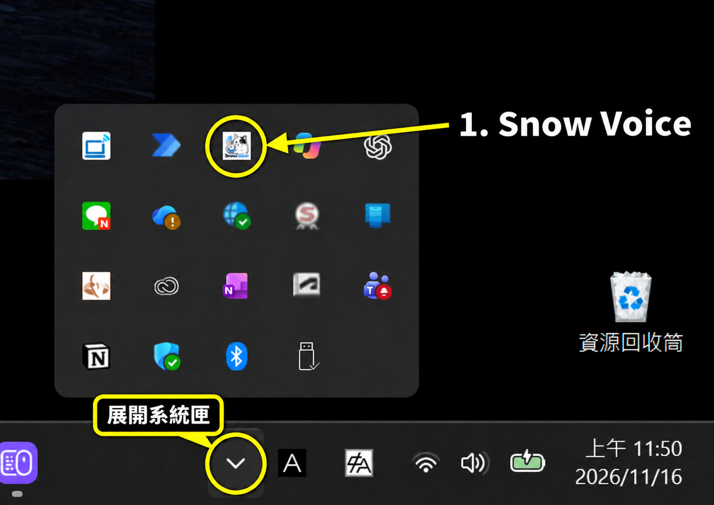
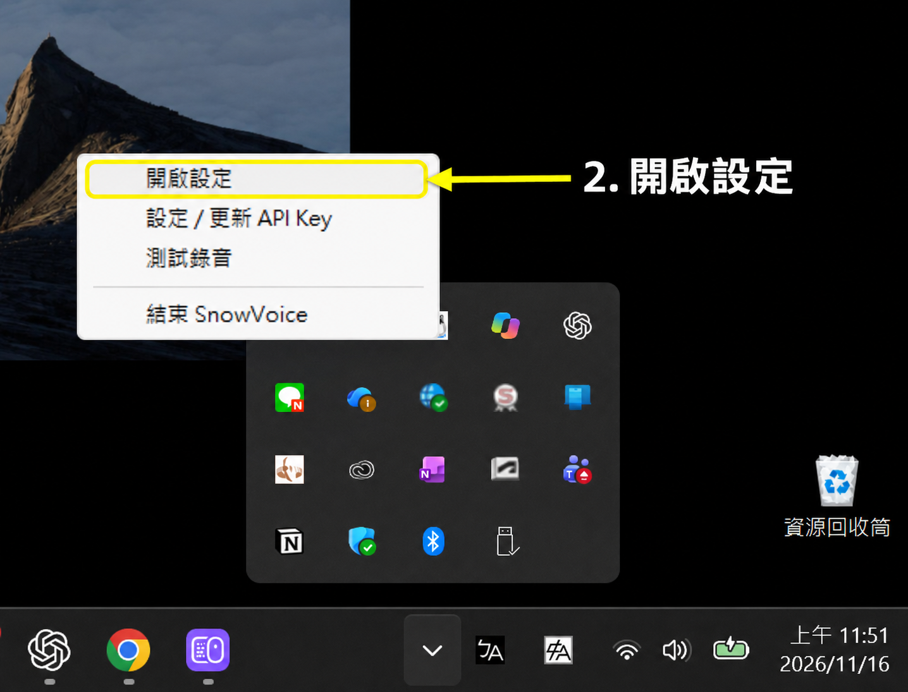
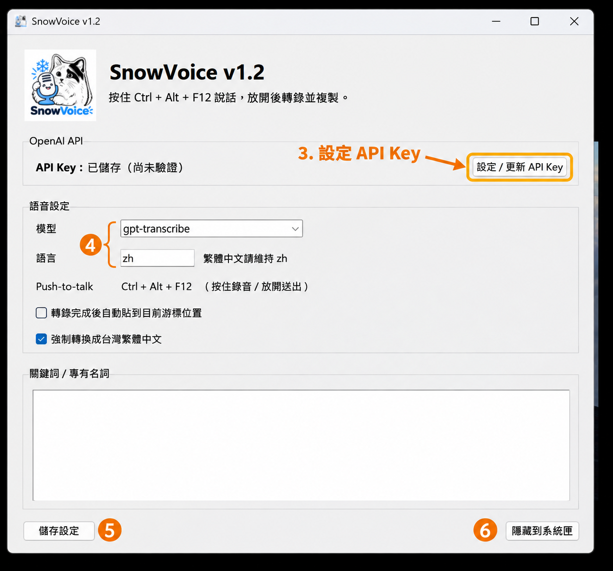
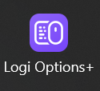
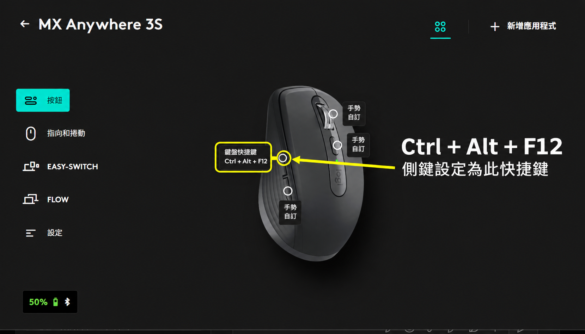

# Snow Voice

**Powered by Snow Lab**


## 🎙️SnowVoice Ver 1.2 


Windows push-to-talk dictation for Traditional Chinese (Taiwan).

按住 **Ctrl + Alt + F12** 錄音 → 放開後送至 OpenAI → 複製文字 → **Ctrl + V** 貼上。

**Preview：尚待 Windows 實機驗收。** 目前提供 Python 原始碼與安裝器，沒有簽章 EXE。

## Ver 1.2 功能

- 空白詞庫，移除個人與公司預設詞彙、私人圖像及舊版資料移轉。
- 保留正常句尾標點、系統匣、繁中轉換與自訂詞庫。
- 獨立設定、金鑰、安裝目錄與開機啟動項。
- 預設只複製；自動貼上須自行啟用，前景視窗改變時跳過貼上。
- 每次錄音最長約 120 秒，API timeout 設為 60 秒，不自動重試。

## 安裝（Windows 10 / 11）

1. 安裝 [Python](https://www.python.org/downloads/windows/) 3.11 以上，包含 Launcher、pip、Tkinter。
2. 下載儲存庫 ZIP 並**完整解壓縮**。
3. 雙擊 `install.bat`。需要網路，依賴從 PyPI 安裝。
4. 在設定視窗填入自己的 OpenAI **Secret Key**（`sk-` 開頭），不要填 `key_` Tracking ID。
5. 在 Windows 隱私設定允許桌面應用程式使用麥克風。
6. 按住快捷鍵說話，放開後稍候，完成後手動貼上。

不需要管理員權限。程式與獨立虛擬環境位於 `%LOCALAPPDATA%\SnowVoicePure\App`。

預設不新增開機啟動；需要時可在解壓縮資料夾執行：

```bat
install.bat --startup
```

用 `start_snowvoice.bat` 開啟設定。關閉設定只會隱藏，請從系統匣選「結束」關閉。
更新前先關閉此版本，再重新安裝。此版本與原版**快捷鍵相同，請勿同時執行**。

內部儲存識別沿用 `SnowVoicePure`，以相容先前安裝的設定與金鑰。

## 第一次使用：圖文操作教學

先完成上方安裝。以下圖片為標註示意，圖示與文字可能因版本略有不同；API Key 與個人詞庫不會隨程式提供。

### 1. 找到 Snow Voice

點 Windows 右下角的 **向上箭頭（隱藏的圖示）**，找到 Snow Voice 圖示。下圖黃色圈選的是 Snow Voice；不同版本也可能顯示麥克風圖示。



找不到圖示時，先執行下載資料夾內的 `start_snowvoice.bat`。關閉設定視窗只會隱藏程式；要完全離開，請選系統匣選單中的「結束 SnowVoice」。

### 2. 開啟設定

在 Snow Voice 圖示上按 **滑鼠右鍵 → 開啟設定**。



### 3. 設定自己的 API Key

點「**設定 / 更新 API Key**」，貼入自己的 OpenAI **Secret Key**，再按該視窗的「**儲存 API Key**」。可到 [OpenAI API Keys](https://platform.openai.com/api-keys) 建立或管理金鑰。

- 使用完整 `sk-` 開頭的 Secret Key，**不要填 `key_` Tracking ID**。
- 金鑰不要放到 GitHub、聊天室或截圖裡。每位使用者各自設定，並負擔自己的 API 用量。
- **已儲存不等於已驗證有效**；第一次實際轉錄成功後，才確認整條流程可以運作。



### 4. 確認語音設定

| 設定 | 建議起始值／用途 |
| --- | --- |
| 模型 | `gpt-transcribe`；需有該模型的使用權限 |
| 語言 | `zh` |
| 強制轉換成台灣繁體中文 | 勾選 |
| 轉錄完成後自動貼上 | 初次使用先不勾選，確認流程後再自行啟用 |
| 關鍵詞／專有名詞 | 可留白；需要時輸入自己常用的詞彙 |

### 5. 儲存設定

按左下角「**儲存設定**」。API Key 有自己的儲存按鈕；此處儲存的是模型、語言與其他偏好。

### 6. 隱藏到系統匣

按右下角「**隱藏到系統匣**」，Snow Voice 會繼續在背景執行。

### 7. 開始語音輸入

1. 開啟記事本等可輸入文字的程式，點選輸入位置。
2. **按住 Ctrl + Alt + F12** 說話；放開後開始轉錄。
3. 等系統匣提示文字已複製，再按 **Ctrl + V** 貼上。
4. 如果有啟用自動貼上，等待期間請維持原本視窗與游標位置。

也能透過下方 Logi Options+ 教學將快捷鍵指定給滑鼠側鍵。若錄不到聲音，先確認 Windows 允許桌面應用程式使用麥克風。

## 用 Logi Options+ 設定滑鼠語音輸入

使用支援 [Logi Options+](https://www.logi.com/en-us/software/logi-options-plus) 的 Logitech 滑鼠，可以把自訂按鍵指定為 SnowVoice 的語音快捷鍵，減少每次按鍵盤的操作。



以下以 **MX Anywhere 3S** 側鍵為例：

1. 先完成 SnowVoice 安裝與 API Key 設定，確認程式正在系統匣執行。
2. 開啟 **Logi Options+**，選擇滑鼠，進入「**按鈕**」。
3. 點選要使用的側鍵，將動作設為「**鍵盤快捷鍵**」。
4. 輸入 **Ctrl + Alt + F12**。需要跨程式使用時，請在全域設定中指定，並檢查是否有應用程式專屬設定覆蓋它。
5. 測試按住該滑鼠鍵時是否持續錄音，放開後是否開始轉錄；完成後按 **Ctrl + V** 貼上文字。若自行啟用 SnowVoice 的自動貼上，請維持原本的視窗與游標位置。



> **先確認長按行為：** SnowVoice Ver 1.2 使用「按住錄音、放開送出」。截圖示範的是快捷鍵指派，並不保證每種裝置或 Options+ 版本都會持續送出按下狀態。若按住滑鼠鍵卻立刻結束錄音，請改用鍵盤按住 **Ctrl + Alt + F12**；目前沒有「按一下開始、再按一下停止」模式。

按鍵指派方式也可參考 [Logitech 官方設定教學](https://hub.sync.logitech.com/options/post/programming-buttons-and-keys-in-options-ntwM6VsAEKhHACY)。Logi Options+ 負責傳送快捷鍵；錄音與轉錄由 SnowVoice 處理。

## API、費用與資料

- 需要自己的 [OpenAI API 帳號與額度](https://platform.openai.com/)。ChatGPT 訂閱不包含此工具的 API 費用。
- 預設模型 `gpt-transcribe`；設定欄可輸入其他有權使用的轉錄模型，見 [官方文件](https://developers.openai.com/api/docs/guides/speech-to-text)。
- 錄音與自訂詞彙傳送至 `https://api.openai.com/v1/audio/transcriptions`；不是離線辨識。
- 金鑰由 `keyring` 儲存至 Windows Credential Manager，服務 `SnowVoicePure_OpenAI`、使用者 `default`。
- 「已儲存」僅表示本機保存，並不表示已通過線上驗證；此專案不附帶任何金鑰。
- 設定和精簡日誌位於 `%APPDATA%\SnowVoicePure`，不主動記錄逐字稿或完整 API 錯誤回應。
- WAV 位於系統暫存資料夾；轉錄完成或失敗後會嘗試刪除，強制結束與斷電可能留下檔案。
- 成功後會取代剪貼簿內容，也可能進入系統的剪貼簿歷程。

## 移除

從**解壓縮的下載資料夾**執行 `uninstall_snowvoice.bat`。只移除此版本程式與開機項，保留設定及金鑰。
完整清除時，自行刪除 `%APPDATA%\SnowVoicePure`，並從 Windows「認證管理員」刪除 `SnowVoicePure_OpenAI` 對應項目。

## 開發與驗收

```bat
python -m unittest discover -s tests -v
python -m compileall -q .
```

離線測試不需要金鑰，不呼叫 API。GitHub Actions 在 Windows 執行語法和離線測試。
依賴指定最低版本，尚未提供鎖定檔，實際安裝版本可能隨 PyPI 更新。

待 Windows 實機確認：

- [ ] 首次安裝、重裝、系統匣與設定保存。
- [ ] 麥克風、快捷鍵、120 秒錄音上限。
- [ ] 實際轉錄與無效金鑰、斷線、用量限制。
- [ ] 手動貼上、自動貼上、切換視窗與系統管理員視窗。
- [ ] 開機啟動與解除安裝。

自動貼上只檢查前景視窗，不能確認同一視窗內的游標，也不能完全排除檢查後切換視窗的競態；手動貼上是預設。

## 授權

目前尚未指定開源授權。公開可見不代表允許自由再散布；確定授權後再加入 LICENSE。
